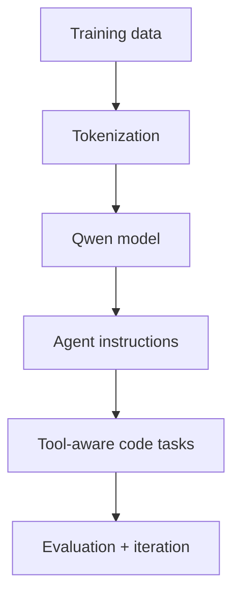

# Qwen Code Agent

<div align="center">


</div>

An experiment workspace for exploring Qwen-powered code-agent workflows, model training artefacts, and notebook-driven development.

## Why this repository exists

This project captures the path from a language model checkpoint to a useful coding assistant: preparing data, training or adapting a model, testing its behaviour, and packaging the result for repeatable experiments.

## Workflow



## Repository contents

- Kaggle-ready training notebook(s)
- Model and router experiments
- Supporting bundle and notes for reproducible runs

## Getting started

Open `codeagent_kaggle_training.ipynb` in Kaggle or Jupyter, review the configuration cells, and run the notebook in order. Keep credentials and model tokens in environment secrets—never commit them.

```bash
pip install jupyter transformers datasets peft accelerate
jupyter notebook
```

## Responsible use

Validate generated code before execution, isolate tools with least privilege, and treat model output as untrusted until tested.

## License

See the repository files for the applicable license and dataset terms.
